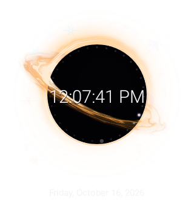

# RabbitGlance · Black Hole 0.1.0

Primera prueba de una aplicación de widgets independiente. Sólo incluye el Agujero Negro recuperado. Usa `RemoteViews.DrawInstructions`: el reproductor del sistema evalúa los movimientos en el proceso del host. No es un launcher.

**Estado:** esta compilación debe probarse en Motorola Edge 50 Ultra con Android 17. Una prueba local del framework no certifica Moto App Launcher ni su consumo.



## Instalar y colocar

1. Descarga `RabbitGlance-0.1.0-Black-Hole.apk`. Permite instalar desde la aplicación con la que abras ese APK cuando Android lo solicite.
2. Abre RabbitGlance. Ajusta tamaño de figura, intensidad y velocidad. La vista previa debe mostrar el material y las estelas en movimiento.
3. Pulsa **Añadir a la pantalla de inicio** y confirma el diálogo de Android. También puedes mantener pulsado el escritorio → **Widgets → RabbitGlance → Black Hole**.
4. Desde el selector de widgets, guarda la configuración para completar la colocación. Mantén pulsado el widget para redimensionarlo. Tócalo para editar esa instancia.
5. Abre **Diagnóstico**, selecciona la instancia colocada, registra si se anima y copia el informe. Observa el escritorio antes de marcar que funciona.

Se instala como `com.isaaclisi.rabbitglance`; convive con el reloj anterior. Pausar congela exclusivamente la vista previa. La figura conserva escala proporcional al redimensionar.

## Qué conserva

Material original de `BlackHoleArt.kt`: disco inclinado y turbulento, filamentos, beaming Doppler D³ acotado, arco asimétrico de lente, neblina y anillo fotónico. Conserva 18 estelas por mitad, con velocidades radiales diferentes y brillo dependiente de su posición. Las dos mitades se dibujan a ambos lados del horizonte para preservar profundidad.

El ambiente, la silueta central y su gradiente/ribete proceden de `OriginalWidgetArt.kt`. Se conservan puntos del calendario con estela de minuto, reloj digital según formato del sistema o esfera analógica, fecha y estrellas opcionales. El color inicial usa la paleta térmica fija original; no intenta adivinar los colores de tu antiguo fondo.

Los materiales se precalculan al construir el documento. **No son un vídeo ni una secuencia de fotogramas.** Las estelas, su opacidad, el reloj y las luces de los puntos son operaciones dinámicas del host.

La distorsión AGSL/malla del fondo pertenecía a `CosmicWallpaperRenderer`, no al widget anterior. No se exporta ese wallpaper ni se finge deformar contenido de otras aplicaciones. Se conserva el arco óptico que sí formaba parte del widget. Detalle completo y límites: [informe](docs/INFORME.md).

## Arquitectura

- `SceneSettings.kt`: modelo acotado de escena y preferencias por instancia.
- `BlackHoleArt.kt`: materiales y flujo del código recuperado.
- `BlackHoleScene.kt`: composición única de capas, indicadores y reloj.
- `ClockDrawDocument.kt`: serializador del subconjunto de protocolo de plataforma V6 heredado. Conserva los bits IEEE NaN.
- `MainActivity.kt`: configuración y vista previa con `RemoteViews.apply`, el mismo reproductor de Android que interpreta el documento publicado.
- `BlackHoleWidget.kt`: proveedor real y trabajo finito por evento; sin servicio.
- `Diagnostics.kt`: pruebas locales de operaciones, errores y observación manual del escritorio.
- `reference/original/`: fuentes históricas relevantes, sin cambios; no se compilan.

No se incluye el launcher antiguo, servicio de wallpaper, superposición, permiso de accesibilidad, red o wakelock.

## Compilar

JDK 21 completo (las fuentes usan bytecode Java/Kotlin 17), Android SDK 35, Build Tools 35 y conexión a Google Maven/Maven Central. No hay dependencias de producción salvo Kotlin stdlib; no se empaqueta un reproductor alternativo de AndroidX.

```sh
./gradlew :app:assembleDebug :app:testDebugUnitTest
```

APK: `app/build/outputs/apk/debug/app-debug.apk`. Las pruebas usan Robolectric API 36 con gráficos nativos y generan PNGs en `app/build/evidence/`. Eso sigue siendo una simulación del framework.

Se compila con SDK/target 35 porque las APIs públicas utilizadas están disponibles allí. La reproducción requiere que el firmware admita el documento y lo habilite en el host; Android 17 es el dispositivo objetivo de esta prueba. Tener la API en el SDK no demuestra compatibilidad del launcher.

## Procedencia

Respaldo Google Drive `RabbitGlance_codigo_fuente_reloj_3.8.2.zip`, commit histórico `29d06ad9b1b43a2e6b2df3dcb3f2a1a200f3cf52`. Se comprobaron los SHA-256 de sus 94 archivos textuales frente a `RABBITGLANCE_MANIFEST.json`. Las fuentes seleccionadas se conservan en `reference/`. Ningún repositorio anterior se modifica.

El APK es de prueba y usa firma debug. Mantén su clave de prueba para futuras actualizaciones; no uses esa identidad como firma de publicación comercial.
